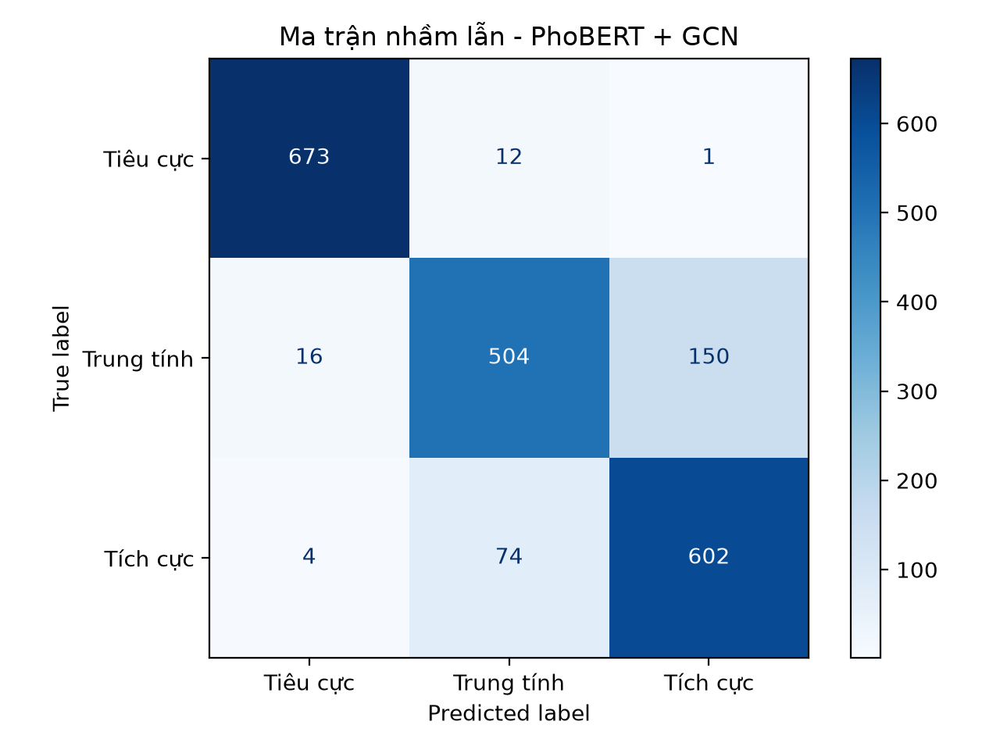
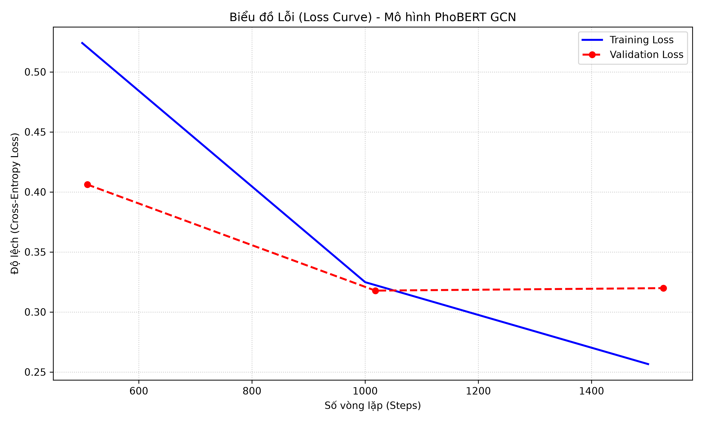
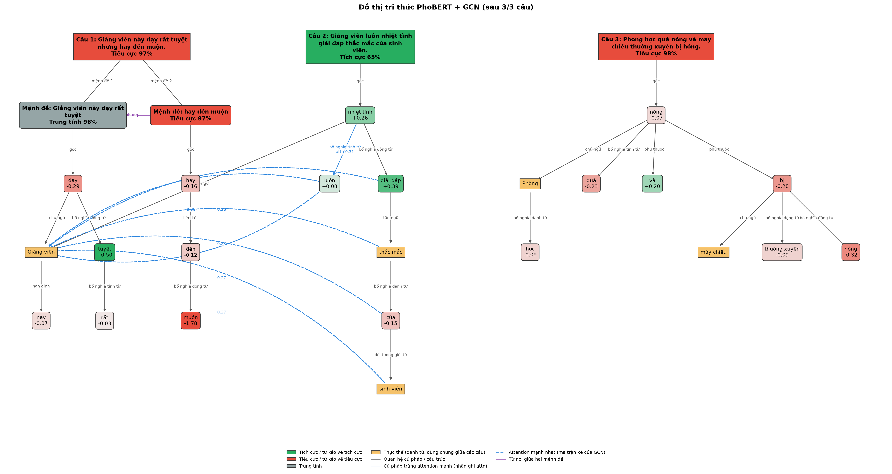

# PhoBERT + GCN: Phân loại cảm xúc văn bản tiếng Việt

Mô hình phân loại cảm xúc 3 lớp (**Tiêu cực / Trung tính / Tích cực**) cho phản hồi của sinh viên. Mô hình kết hợp **PhoBERT** (`vinai/phobert-base`) với **Graph Convolutional Network (GCN)**: mỗi câu được coi là một đồ thị, trong đó token là node, còn ma trận Self-Attention của PhoBERT là ma trận kề.

## Kết quả

Đánh giá trên tập validation (2.036 câu) bằng `python evaluate.py`:

| Lớp | Precision | Recall | F1 | Số câu |
|---|---:|---:|---:|---:|
| Tiêu cực | 0.9711 | 0.9810 | 0.9761 | 686 |
| Trung tính | 0.8542 | 0.7522 | 0.8000 | 670 |
| Tích cực | 0.7995 | 0.8853 | 0.8402 | 680 |
| **Weighted avg** | **0.8753** | **0.8738** | **0.8727** | 2036 |

**Accuracy: 87.38%**, macro F1: 0.8721. Accuracy theo từng chủ đề: curriculum 86.4%, facility 85.6%, lecturer 86.8%, others 91.0%.

<p align="center">
  
  
</p>

Phần lớn lỗi nằm ở việc nhầm giữa **Trung tính** và **Tích cực**: 150 câu trung tính bị đoán là tích cực, 74 câu tích cực bị đoán là trung tính. Lớp Tiêu cực gần như được phân loại đúng hoàn toàn.

## Kiến trúc mô hình

```
Câu đầu vào
  │  Chuẩn hóa Unicode NFC + tách từ (VnCoreNLP):  "Giảng_viên dạy rất dễ hiểu ."
  ▼
PhoBERT-base (12 layer, fine-tune toàn bộ)
  ├── H = last_hidden_state            (batch, seq, 768)   → đặc trưng node
  └── A = attention layer cuối, trung bình 12 head  (batch, seq, seq) → ma trận kề
  ▼
GCN 1:  ReLU(A · H W₁ + b₁)            768 → 256
GCN 2:  ReLU(A · X W₂ + b₂)            256 → 128
  ▼
Global Mean Pooling (bỏ qua padding)  → graph embedding 128 chiều
  ▼
Linear → 3 lớp, hàm mất mát Cross-Entropy
```

Mỗi hàng của ma trận attention đã được Softmax chuẩn hóa (tổng bằng 1), nên có thể dùng trực tiếp làm ma trận kề đã chuẩn hóa mà không cần tính thêm `D^-1/2 A D^-1/2`.

## Dữ liệu

| Tập | Số câu | Tiêu cực | Trung tính | Tích cực |
|---|---:|---:|---:|---:|
| `data/synthetic_train.csv` | 8.144 | 2.711 | 2.724 | 2.709 |
| `data/synthetic_val.csv` | 2.036 | 686 | 670 | 680 |

- Các cột: `sentence`, `sentiment` (`negative` / `neutral` / `positive`), `topic` (`lecturer`, `curriculum`, `facility`, `others`).
- Dữ liệu tổng hợp (synthetic), cân bằng giữa các lớp và các chủ đề. Không có câu trùng lặp, không có câu nào xuất hiện ở cả tập train và tập validation.
- Khoảng 4% số câu là tiếng Anh.

## Cấu trúc dự án

```
├── model.py              # Cấu hình chung, kiến trúc PhoBertGCN, VnCoreNLP, tiền xử lý
├── train_gcn.py          # Huấn luyện mô hình
├── evaluate.py           # Đánh giá mô hình: classification report, ma trận nhầm lẫn
├── predict.py            # Dự đoán câu mới (dòng lệnh hoặc tương tác)
├── visualize_graph.py    # Trực quan hóa đồ thị tri thức và ma trận attention
├── requirements.txt
├── data/                 # Dữ liệu train / validation
├── results/              # Kết quả: metrics, biểu đồ, đồ thị
│   ├── evaluation.json       # Chỉ số chi tiết của best_model
│   ├── confusion_matrix.png
│   ├── loss_curve.png
│   ├── training_log.txt      # Log huấn luyện gốc (14/10/2026)
│   └── graphs/               # Đầu ra của visualize_graph.py
└── phobert_gcn_model/
    └── best_model/       # Trọng số đã huấn luyện (model.safetensors, ~518MB) + tokenizer
```

## Cài đặt

**Yêu cầu:**
- Python 3.9 trở lên (đã kiểm thử với 3.12)
- **Java JDK 8 trở lên**, vì VnCoreNLP chạy trên Java. Có thể cài từ [Adoptium](https://adoptium.net), sau đó đặt biến môi trường `JAVA_HOME`.
- GPU NVIDIA là tùy chọn. Code tự dùng CUDA nếu có, không thì chạy trên CPU.
- [Graphviz](https://graphviz.org/download/) là tùy chọn, chỉ dùng để `visualize_graph.py` vẽ đồ thị đẹp hơn.

```bash
python -m venv venv
venv\Scripts\activate            # Windows
source venv/bin/activate         # Linux / macOS

# 1. Cài PyTorch đúng với máy (xem https://pytorch.org/get-started/locally/), ví dụ với CUDA 12.4:
pip install torch --index-url https://download.pytorch.org/whl/cu124
# 2. Cài các thư viện còn lại
pip install -r requirements.txt
```

Ở lần chạy đầu tiên, chương trình tự tải:
- VnCoreNLP (khoảng 150MB) về `./vncorenlp`. Nếu đường dẫn dự án có dấu cách thì tải về `~/.cache/vncorenlp`. Có thể chỉ định thư mục khác bằng biến môi trường `VNCORENLP_DIR`.
- Config và tokenizer của `vinai/phobert-base` từ Hugging Face Hub.

**Trọng số đã huấn luyện:** thư mục `phobert_gcn_model/` không được đưa lên git vì dung lượng lớn. Để chạy `predict.py`, `evaluate.py` hoặc `visualize_graph.py` mà không cần huấn luyện lại, hãy đặt thư mục `best_model/` vào `phobert_gcn_model/best_model/`.

## Sử dụng

### Huấn luyện

```bash
python train_gcn.py                                 # Siêu tham số mặc định (đã dùng cho mô hình hiện tại)
python train_gcn.py --epochs 5 --lr 2e-5 --batch-size 32
python train_gcn.py --help                          # Xem tất cả tùy chọn
```

| Siêu tham số | Giá trị |
|---|---|
| Learning rate | 3e-5 (AdamW, giảm tuyến tính) |
| Batch size | 16 |
| Số epoch | 3 |
| Weight decay | 0.01 |
| Độ dài tối đa | 128 token |
| Seed | 42 |

Trên GPU RTX A2000 Laptop (8GB), quá trình huấn luyện mất khoảng 13 phút. Sau mỗi epoch, mô hình được đánh giá trên tập validation, và checkpoint có **F1 cao nhất** được giữ lại làm `best_model`. Kết quả được ghi vào `results/metrics.json` và `results/loss_curve.png`. Các checkpoint trung gian (mỗi cái khoảng 1.6GB) sẽ bị xóa sau khi huấn luyện xong, trừ khi chạy với `--keep-checkpoints`.

### Đánh giá

```bash
python evaluate.py
python evaluate.py --data path/to/test.csv          # File CSV phải có cột sentence, sentiment
```

### Dự đoán

```bash
python predict.py "Phòng học quá nóng, máy chiếu hay hỏng."
#  => Tiêu cực    (98.40%) | Tiêu cực:  98.4%  Trung tính:   1.3%  Tích cực:   0.3%

python predict.py                                   # Chế độ tương tác, gõ 'exit' để thoát
```

### Trực quan hóa đồ thị

```bash
python visualize_graph.py
python visualize_graph.py "Câu thứ nhất." "Câu thứ hai." --top-k 2
```

<p align="center"></p>

Đồ thị tri thức được xây dựng bằng các lớp Pydantic `Node`, `Edge` và `KnowledgeGraph`, với hai phương thức `update()` và `draw()`:

- **Phân tầng:** câu → mệnh đề → từ. Câu được tách thành mệnh đề tại "nhưng", dấu phẩy, v.v. Mỗi câu và mỗi mệnh đề được tô màu theo cảm xúc dự đoán, kèm độ tin cậy.
- **Cạnh liền:** quan hệ cú pháp phụ thuộc lấy từ VnCoreNLP (chủ ngữ, bổ nghĩa, trạng ngữ, ...). Nếu attention cũng mạnh trên cặp từ đó thì nhãn cạnh có thêm `attn`.
- **Cạnh nét đứt:** những liên kết attention mạnh nhất trong ma trận kề mà GCN thực sự dùng, nhưng không trùng với quan hệ cú pháp.
- **Màu của từ:** mức đóng góp của từ vào `P(tích cực) − P(tiêu cực)`, tính bằng **Integrated Gradients**. Màu xanh kéo câu về tích cực, màu đỏ kéo về tiêu cực.
- **Cập nhật lặp:** các câu được gộp dần vào cùng một đồ thị. Danh từ (thực thể) được dùng chung, nên các câu cùng nhắc đến "giảng viên" sẽ nối với nhau.

Đầu ra nằm trong `results/graphs/`: `iteration_<i>.png` (đồ thị sau mỗi câu), `final.png`, file nguồn Graphviz `.gv`, và `attention_heatmap_<i>.png` (ma trận kề mức từ, so sánh PhoBERT gốc với PhoBERT sau fine-tune).

## Hạn chế và hướng phát triển

- **Trung tính và Tích cực dễ bị nhầm với nhau.** Ví dụ, "Giảng viên dạy rất dễ hiểu và nhiệt tình." bị dự đoán là Trung tính (63%). Hướng cải thiện: bổ sung dữ liệu thật cho hai lớp này, hoặc dùng class weight / focal loss.
- **Dữ liệu là dữ liệu tổng hợp.** Mô hình chưa được đánh giá trên phản hồi thật của sinh viên.
- **Chưa có tập test riêng.** Tập validation được dùng cả để chọn checkpoint lẫn để báo cáo kết quả, nên số liệu trên có thể cao hơn một chút so với hiệu năng thực tế. Nên tách thêm một tập test độc lập.
- **Ma trận kề chỉ lấy từ attention của layer cuối.** Có thể thử kết hợp thêm cây cú pháp phụ thuộc (syntactic GCN) hoặc attention của nhiều layer.
